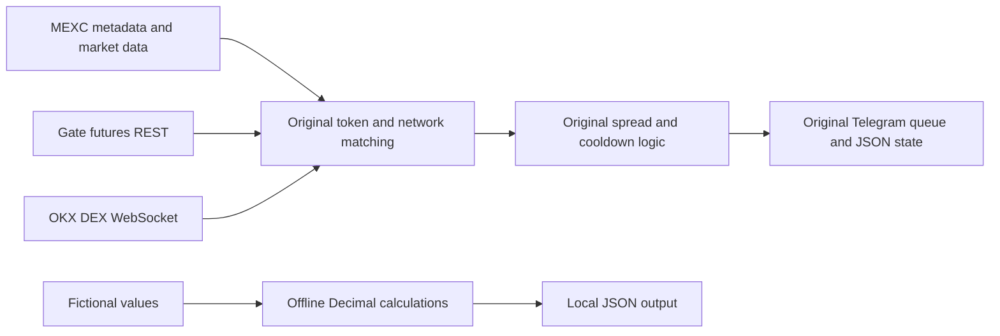

# Cross-Exchange Price Monitor Research

**Portfolio category: Programming / Software Engineering.**

An offline calculation package and a quarantined historical Python monitor. The original asynchronously combines MEXC and Gate futures information with OKX DEX streams, matches token contracts and networks, selects pairs by available liquidity, tracks deposit/withdrawal status, and queues Telegram alerts. It includes ban/mute state and chat commands. No order-submission implementation was found in this monitor.

## Problem and scope

Investigate cross-source price differences while distinguishing symbol, network and contract identity. The local runnable example demonstrates notional units and percentage differences only. It does not start the full monitor, subscribe to market data or send messages. Source provenance: `spread-mex/spread.py`.

## Implemented components

- Original async HTTP/WebSocket monitoring, token/network mapping, subscription refresh and reconnect loops retained for source inspection.
- Original alert queues, cooldowns, statistics and local JSON persistence retained in the quarantined source.
- An offline `Decimal` implementation of `maxVol × price × contractSize` with finite positive input validation.
- An offline price-difference example using explicitly fictional values.

## Technology and data flow

Offline code uses Python's standard library. Historical dependencies are `aiohttp`, `websockets` and `python-telegram-bot`; the original additionally imported `urllib3` only to suppress an insecure-request warning. `requirements.txt` documents unpinned historical dependencies; they were not installed or resolved. The offline package has no dependency on them.



The historical path is blocked by the first statement of `legacy/spread.py`, before any import or side effect. There is no runtime flag to bypass it.

## Requirements, installation and usage

Python 3.10 or later; no dependency installation is needed for these commands. Run from this repository's directory:

```sh
python -m unittest discover -s tests -v
python src/demo.py
```

The demo calculates the maximum notional for fictional contract metadata and a signed percentage difference. It is not an executable arbitrage or profit model. Fees, funding, transfer delays, spread and slippage are excluded.

## Configuration

`.env.example` contains fictional historical placeholders. The copied historical source reads process environment values with `os.environ`; `.env` is not automatically loaded. Real bot tokens, chat IDs and exchange credentials were removed from the copy. The offline example needs none of these values.

## Security considerations

This repository uses a sanitized source snapshot and a new Git history. Historical credentials were excluded. Credentials previously committed to older versions must be revoked at the provider; sanitizing a copy does not revoke them.

The copy restores TLS verification at the seven `ssl=False` call sites, removes the private `session._default_ssl` override and warning suppression, removes a referral identifier, and changes command authorization to deny requests when the admin allowlist is empty. These edits passed syntax checks; the networking behavior remains untested.

The historical signed deposit/withdrawal metadata request does not justify trading or withdrawal privileges. No account permissions were validated. Never send real credentials during testing.

## Verification

Five unit tests passed with Python 3.14.7, covering units, exact decimal examples, percentage direction and rejection of invalid values or zero reference prices. The fictional demo passed. Both original and copied Python source parsed successfully. The [GitHub Actions workflow](https://github.com/Psiblame/cross-exchange-price-monitor/actions/workflows/check.yml) runs these offline checks on pushes and pull requests.

## Known limitations and future work

- The historical monitor is a monolith with global state, file persistence and many concurrent tasks. Cancellation, bounded queues and atomic writes need further testing.
- Very frequent Gate polling and subscription refresh loops need an explicit global rate budget.
- Reconnect loops exist, but task cleanup and missing/stale data behavior need a simulated transport test suite.
- Historical float calculations remain in the inert source; only the offline calculation module uses Decimal.
- Chat command behavior and the allowlist require integration tests; bot initialization and network clients are not safe library imports.
- Exact dependency versions and endpoint formats are unresolved. No claim of production readiness or profitability is made.

## Repository scope and licensing

This repository contains a sanitized source snapshot and offline helpers. The original Git history is not included. No license has been selected. The network runtime remains unsupported.
